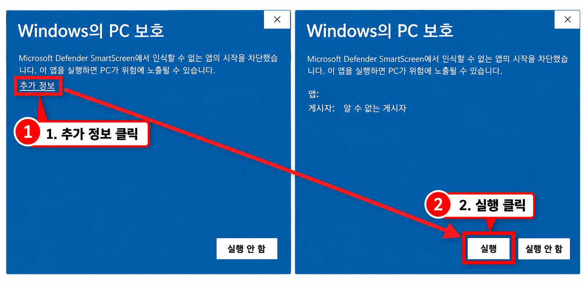

# 선린밸리 Windows 설치 가이드

Windows x64용 선린밸리 런처 1.0.0 기준입니다.

## 1. 설치 파일 받기

[공식 1.0.0 다운로드 페이지](https://github.com/mingyu1715/sunrin-valley/releases/tag/launcher-1.0.0)를 열고, **Assets**에서 **`Sunrin-Valley-Setup-1.0.0-x64.exe`**를 받습니다.

Mac용 ZIP이나 `Source code`가 아닌 Windows 설치 파일을 선택해 주세요.

## 2. ‘Windows의 PC 보호’가 나타나면

현재 버전은 코드 서명을 적용하지 않아 Microsoft Defender SmartScreen 경고가 표시될 수 있습니다. [Microsoft의 SmartScreen 설명](https://learn.microsoft.com/en-us/windows/apps/package-and-deploy/smartscreen-reputation)

**위 공식 GitHub에서 받은 선린밸리 설치 파일인지 확인한 뒤** 다음 순서로 진행합니다.

1. 설치 파일을 실행합니다.
2. 파란색 **Windows의 PC 보호** 창에서 **추가 정보**를 누릅니다.
3. 표시되는 앱 이름이 다운로드한 선린밸리 설치 파일인지 확인합니다. 게시자는 **알 수 없는 게시자**로 나올 수 있습니다.
4. 아래의 **실행**을 누릅니다.

> 위 이미지는 앱 이름을 가린 **보안 경고 화면 예시**입니다. 실제 화면에서 실행할 파일이 `Sunrin-Valley-Setup-1.0.0-x64.exe`인지 확인해 주세요.

Windows 버전이나 PC 정책에 따라 화면이 다를 수 있습니다. **실행** 버튼이 없거나 다른 차단 안내가 나오면, 보안 기능을 끄는 대신 해당 화면을 캡처해 전달해 주세요.

## 3. 런처와 게임 설치하기

1. 설치 프로그램의 안내에 따라 설치를 완료합니다.
2. 시작 메뉴나 설치한 바로가기에서 **Sunrin Valley**를 실행합니다.
3. 런처의 **게임 설치**를 누릅니다.
4. 다운로드·설치 예상 용량과 현재 여유 공간을 확인하고 **설치 진행**을 누릅니다.
5. 모드팩·리소스팩·한국어 설정·Java 17·Prism 준비가 끝날 때까지 기다립니다. Java나 모드를 따로 설치할 필요는 없습니다.

설치 위치와 게임 메모리는 **설정**에서 바꿀 수 있습니다. 메모리는 처음 추천된 값을 사용하면 됩니다. 설정에서 현재 설치 용량과 버전도 확인할 수 있습니다.

## 4. 로그인하고 실행하기

1. 설치가 끝나면 **게임 실행**을 누릅니다.
2. 필요하면 Prism의 계정 추가 또는 Microsoft 로그인 창이 열립니다. Minecraft Java Edition을 이용할 수 있는 Microsoft 계정으로 안내에 따라 로그인합니다.
3. 로그인 중에는 인증 창을 닫지 말고 완료해 주세요.
4. 런처가 **준비하는 중**을 표시하며 **로그인 확인 → 게임 준비 → 게임 실행** 순서로 진행합니다. 첫 실행에는 Minecraft·Forge 파일을 추가로 받을 수 있습니다.

로그인과 게임 옵션은 다음 실행에도 유지됩니다. 게임을 켤 때마다 전체 모드팩을 다시 설치하지 않습니다.

## 5. 업데이트와 문제 해결

- 다음부터는 **게임 실행**을 누르면 운영 버전을 확인합니다. 업데이트가 있으면 버튼이 **업데이트가 있습니다**로 바뀝니다. 다시 눌러 용량 안내의 **설치 진행**을 선택하면 업데이트 후 게임을 실행합니다.
- 오류가 나면 안내창의 **상세 정보**를 확인하고 **오류 정보 복사** 또는 **진단 파일 저장**으로 내용을 전달해 주세요.
- 로그인 창이 보이지 않으면 **설정 → 문제 해결 → Prism 직접 열기**를 사용합니다.
- 설치 복구가 필요하면 게임과 Prism을 닫고 **설정 → 문제 해결 → 설치 복구**를 누릅니다.

삭제하려면 **제어판 → 프로그램 제거 → Sunrin Valley → 제거** 또는 Windows 설정의 **설치된 앱**을 이용합니다. 전용 모드·로그인 정보·월드도 함께 삭제되므로 **월드는 먼저 백업**해 주세요. 기존 Minecraft 폴더는 유지됩니다.
